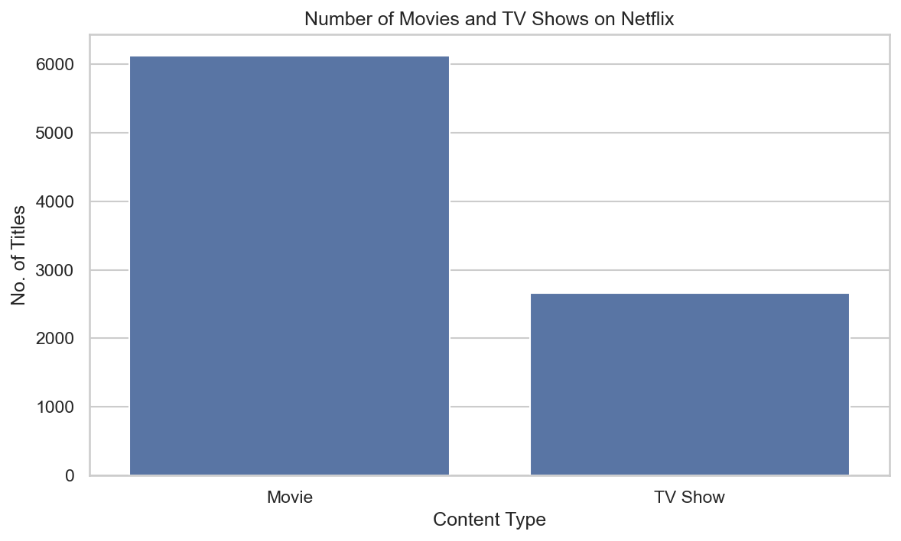
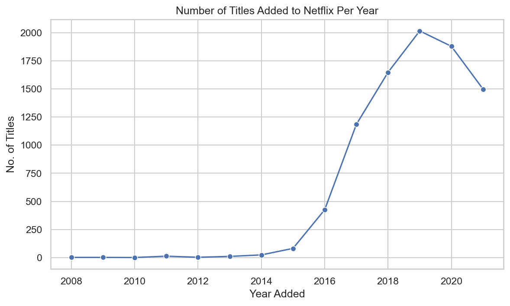
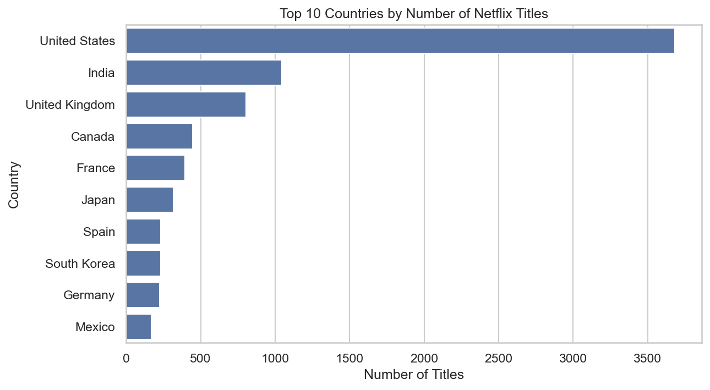
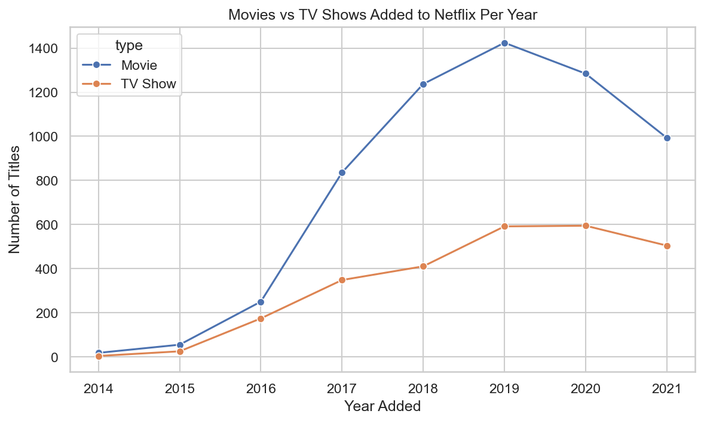

# Netflix Titles: Exploratory Data Analysis and Visual Storytelling

An exploratory analysis of 8,807 Netflix movies and TV shows, with 10 charts and a written insight under each one.

## Dataset

[Netflix Movies and TV Shows](https://www.kaggle.com/datasets/shivamb/netflix-shows) by Shivam Bansal on Kaggle (`data/netflix_titles.csv`). The data runs up to September 2021.

## Questions

1. How is the catalog split between movies and TV shows?
2. How long is a typical movie, and how many seasons do TV shows run?
3. How has the library grown, and which countries and genres dominate?
4. Do movies and TV shows target different audiences?

## Data Cleaning

- Filled missing `director`, `cast` and `country` with "Unknown" to keep thousands of titles
- Dropped 17 rows missing `rating`, `duration` or `date_added` (under 0.2% of the data)
- Converted `date_added` to a real date and created `year_added` and `month_added`
- Extracted a numeric `duration_num` (minutes for movies, seasons for TV shows)
- Split multi-value columns (`country`, `listed_in`) so each country and genre is counted separately

## Key Findings

- **Movies dominate:** about 70% of titles are movies (6,126) and 30% are TV shows (2,664).
- **Typical movie length:** the median is 98 minutes, and the middle half of movies run 87 to 114 minutes.
- **Growth took off after 2015:** the peak was 2019 with 2,016 titles added. Movies outpaced TV shows every year. The 2021 drop is partly because the data ends in September.
- **The US leads by far** with 3,680 titles, followed by India (1,046) and the United Kingdom (803).
- **The catalog leans mature:** TV-MA and TV-14 are the top ratings. International Movies (2,752) and Dramas (2,426) are the top genres.
- **Most TV shows are short runs:** about 67% have only one season.

## Selected Charts






All 10 charts are in the [`images/`](images) folder and in the notebook.

## Project Structure

```
netflix-eda-visual-storytelling/
├── data/         # raw dataset
├── notebooks/    # netflix_eda.ipynb
├── images/       # exported charts
├── requirements.txt
└── README.md
```

## How to Run

```bash
git clone https://github.com/baasirahmad46/netflix-eda-visual-storytelling.git
cd netflix-eda-visual-storytelling
pip install -r requirements.txt
jupyter notebook
```

Then open `notebooks/netflix_eda.ipynb` and choose **Kernel → Restart & Run All**.

## Limitations

- 2021 is a partial year (data ends in September).
- Titles with several countries or genres are counted once per country or genre, so those totals overlap.
- The dataset is used as provided and was not independently verified.

## Tools

Python, pandas, NumPy, Matplotlib, Seaborn, Jupyter.

## Author

Baasir Ahmad · [GitHub](https://github.com/baasirahmad46) ·

## License

MIT. The dataset belongs to its original author on Kaggle.
